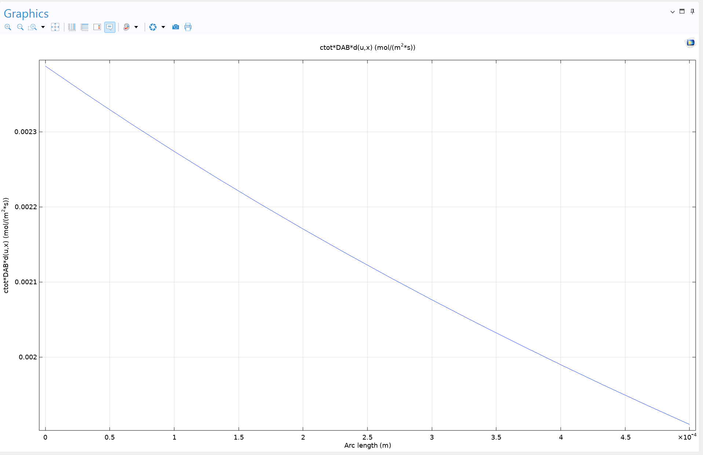
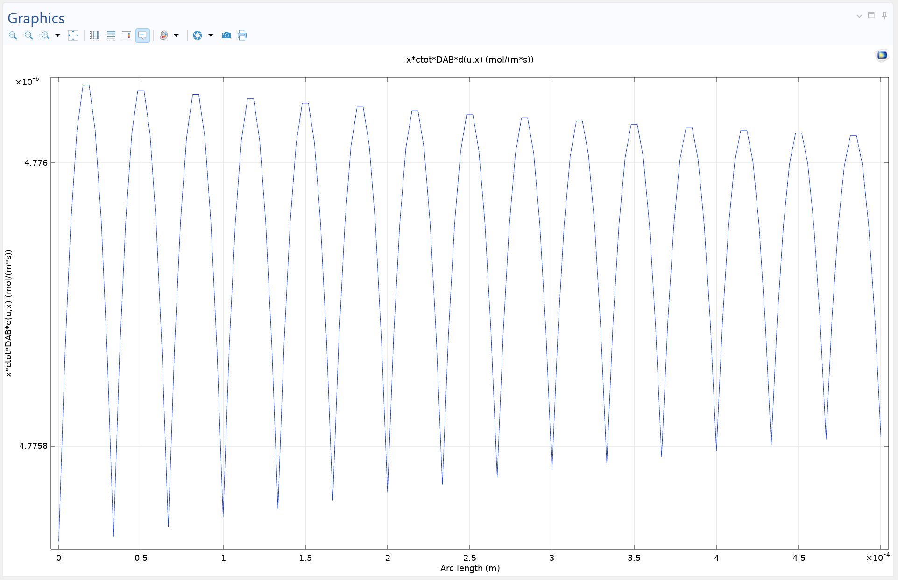
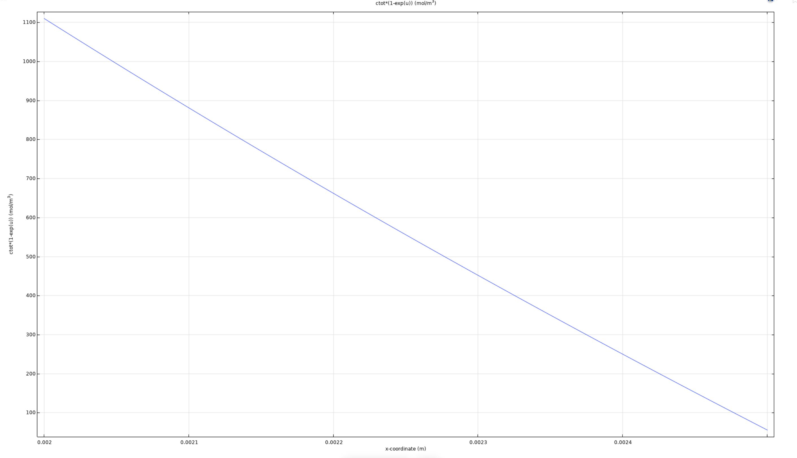

# Mass Transfer Practice Problems

Worked solutions for cylindrical drug release, dissolution in a well-mixed bath, diamond deposition, and dissolution from a flat slab.

## Contents

- [Notation and units](#notation-and-units)
- [Problem 1 — Drug diffusion from a cylindrical pill](#problem-1--drug-diffusion-from-a-cylindrical-pill)
- [Problem 2 — Bath bomb dissolving into a well-mixed tub](#problem-2--bath-bomb-dissolving-into-a-well-mixed-tub)
- [Problem 3 — Diamond deposition from methane](#problem-3--diamond-deposition-from-methane)
- [Problem 4 — Water flowing over a dissolving slab](#problem-4--water-flowing-over-a-dissolving-slab)
- [References](#references)

## Notation and units

The mass-transfer coefficient $k_c$ has units of length/time. The molar flux $N_A$ has units of mol/(area·time). The total molar rate $\dot n_A=\int N_A\,dA$ has units of mol/time.

## Problem 1 — Drug diffusion from a cylindrical pill

The model is one-dimensional in space. Concentration and flux vary with radial position, and the cylindrical area grows with radius.

## COSMOL 6.4 

### COMSOL 6.4 workflow — Cylindrical pill diffusion

Use this sequence to reproduce **Problem 1(a)** from a blank model. The model solves for \(u=\ln(1-x_A)\) across the water layer, then converts \(u\) into drug concentration and radial flux.

## 1. Create the stationary 1D model

1. Open **Model Wizard → 1D → Next**. Use ordinary **1D** for this setup.
2. Choose **Mathematics → PDE Interfaces → Coefficient Form PDE → Add**.
3. Keep one dependent variable named `u`, with unit `1`. Keep the source-term unit at the default `m^-2` for the dimensionless PDE coefficient used below.
4. Choose **Study → Stationary → Done**.

## 2. Enter parameters and build the water layer

Under **Global Definitions → Parameters**, enter:

| Name | Expression | Meaning |
|---|---|---|
| `Rpill` | `2[mm]` | Pill radius |
| `delta` | `0.5[mm]` | Water-layer thickness |
| `DAB` | `1e-9[m^2/s]` | Drug diffusivity |
| `ctot` | `55500[mol/m^3]` | Total molar concentration |
| `xAs` | `0.02` | Drug mole fraction at the pill surface |
| `xAbulk` | `0.001` | Drug mole fraction at the outer edge |

Right-click **Geometry 1 → Interval**. Set **Specify** to **Interval lengths**, enter `Rpill` as the **Left endpoint**, and enter `delta` as the **only length**. Click **Build All Objects**.

**Checkpoint:** The latest line in **Messages** should report **1 domain and 2 boundaries**. If the segment is hard to see, click **Zoom Extents**. It runs from **2.0 to 2.5 mm**.

## 3. Set the PDE and endpoint conditions

Open the child node **Coefficient Form PDE 1**. Set the diffusion coefficient **`c`** to **`x/Rpill`** and set the source, absorption, convection, and other flux coefficients to zero. In this stationary, source-free model, `x/Rpill` supplies the cylindrical area factor. The physical diffusivity `DAB` enters when you calculate the drug flux.

Right-click the **parent** node **Coefficient Form PDE (c)** and add **Dirichlet Boundary Condition** twice. In each node, keep **Prescribed value of u** checked, select one endpoint in **Graphics**, and enter its value in the field labeled **`r`**.

| Node | Select this endpoint | Enter in prescribed-value field |
|---|---|---|
| **Dirichlet Boundary Condition 1** | Left, pill surface at 2.0 mm | `log(1-xAs)` |
| **Dirichlet Boundary Condition 2** | Right, outer edge at 2.5 mm | `log(1-xAbulk)` |

**Checkpoint:** Each node should list exactly one boundary ID, and the IDs should be different.

## 4. Mesh and solve

Click **Build Mesh → Compute**. The default plot of `u` should rise from approximately **−0.02020** to **−0.001001**. The physical drug concentration decreases because \(c_A=c_{\mathrm{tot}}(1-e^u)\).

## 5. Make a separate plot for each result

For each row below, right-click **Results → 1D Plot Group**, name the group, and then right-click the group → **Line Graph**. Use **Study 1/Solution 1** as the group’s dataset. In **Line Graph → Selection**, choose **All domains** or manually select **Domain 1**. Enter the expression under **y-Axis Data**, then click **Plot**.

| Plot group | y-Axis expression | Baseline check |
|---|---|---|
| **Drug concentration** | `ctot*(1-exp(u))` | Decreases from **1,110 to 55.5 mol/m³** |
| **Outward radial flux** | `ctot*DAB*d(u,x)` | Decreases from **\(2.388\times10^{-3}\)** to **\(1.910\times10^{-3}\ \mathrm{mol/(m^2\,s)}\)** |
| **Cylindrical balance** | `x*ctot*DAB*d(u,x)` | Nearly constant at **\(4.776\times10^{-6}\ \mathrm{mol/(m\,s)}\)** |

Use `x` on the horizontal axis for **radius**, or `(x-Rpill)/delta` to match the **0-to-1 axis** in your Python plots. A blank graph usually means the domain selection is empty or the parent group has the wrong dataset. In your balance plot, the visible ripples were **less than 0.01%** of the expected value. The tight y-axis scale magnified the small variations from taking the numerical derivative.

## 6. Export the figures and save the model

For each figure, right-click its **1D Plot Group → Add Image to Export**. Open the new node under **Results → Export**, choose **PNG**, enter a distinct filename, and click **Export**. Press **Ctrl+S** to save the `.mph` model with its plot groups and export settings.

## Cylindrical Pill: Radial Flux Equation Integration

## 1. Governing Equations

A steady-state shell balance in cylindrical coordinates yields:

$$
r N_{Ar} = C_1
$$

Combining this shell balance with Fick’s law for diffusion through stagnant water (zero net water flux, $N_{Br} = 0$) gives the governing differential equation:

$$
\frac{C_1}{r} = -\frac{c D_{AB}}{1 - x_A} \frac{dx_A}{dr}
$$

---

## 2. Separation of Variables & Integration

Separating the radial coordinate and composition variables, we integrate from the pill surface ($r = R$, where $x_A = x_{As}$) to an arbitrary radial position $r$ within the water boundary layer:

$$
\underbrace{\frac{C_1}{c D_{AB}} \int_R^r \frac{d\rho}{\rho}}_{\text{radius}} = \underbrace{-\int_{x_{As}}^{x_A(r)} \frac{du}{1 - u}}_{\text{drug mole fraction}}
$$

Evaluating both integrals yields the integrated relationship:

$$
\boxed{
\frac{C_1}{c D_{AB}} \ln\frac{r}{R} = \ln\frac{1 - x_A(r)}{1 - x_{As}}
}
$$

### Physical Interpretation
* **Radius logarithm ($\ln(r/R)$):** Comes from the changing cylindrical surface area ($2\pi r L$) as the radial distance increases.
* **Composition logarithm ($\ln\left[\frac{1 - x_A(r)}{1 - x_{As}}\right]$):** Comes from the $\frac{1}{1 - x_A}$ factor accounting for bulk convective transport induced by unidirectional diffusion of species $A$.

---

## 3. Boundary Conditions & Final Profiles

Set $r = R + \delta$ and $x_A = x_{A\infty}$ at the outer edge of the stagnant water layer to solve for the integration constant $C_1$:

$$
C_1 = \frac{c D_{AB}}{\ln\left(\frac{R + \delta}{R}\right)} \ln\left(\frac{1 - x_{A\infty}}{1 - x_{As}}\right)
$$

Once $C_1$ is determined:
1. **Radial Molar Flux ($N_{Ar}$):** Substitute $C_1$ into the shell balance equation:
   $$
   N_{Ar}(r) = \frac{C_1}{r}
   $$
2. **Concentration Profile ($x_A(r)$):** Rearrange the boxed equation to obtain the drug mole fraction across $R \le r \le R + \delta$:
   $$
   \frac{1 - x_A(r)}{1 - x_{As}} = \left(\frac{1 - x_{A\infty}}{1 - x_{As}}\right)^{\frac{\ln(r/R)}{\ln((R+\delta)/R)}}
   $$

---

## Nomenclature

| Symbol | Description |
| :--- | :--- |
| $c$ | Total molar concentration of the solution |
| $C_1$ | Integration constant ($r N_{Ar}$) |
| $D_{AB}$ | Binary diffusivity of drug $A$ in water $B$ |
| $N_{Ar}$ | Radial molar flux of drug $A$ |
| $r$ | Radial coordinate |
| $R$ | Radius of the cylindrical pill |
| $x_A(r)$ | Mole fraction of drug $A$ at radial position $r$ |
| $x_{As}$ | Mole fraction of drug $A$ at the pill surface ($r = R$) |
| $x_{A\infty}$ | Bulk mole fraction of drug $A$ at $r = R + \delta$ |
| $\delta$ | Thickness of the stagnant water boundary layer |

### Assumptions and limitations

| Major assumption | What it lets us do | When it becomes limiting |
|---|---|---|
| **Steady state at a fixed pill radius $R$** | Set $\partial c_A/\partial t=0$, so the same molar rate crosses every cylindrical surface. | During startup, the concentration profile is still developing. As the pill shrinks, the steady solution can be used at successive radii if the water layer adjusts much faster than the pill dissolves. |
| **Long cylinder with uniform radial transport** | Neglect the ends and write $c_A=c_A(r)$. The area available for transfer is $2\pi rL$. | A short tablet can release a substantial amount through its two flat ends. Uneven flow around the tablet can also make the flux vary with angle and position along its length. |
| **Prescribed water-layer thickness $\delta$ and bulk concentration $c_\infty$** | Set $c_A(R+\delta)=c_\infty$ and solve transport within the layer. | Stirring and flow determine the effective layer thickness. In a finite bath, $c_\infty$ can rise over time, reducing the driving force. The model takes both quantities as inputs. |
| **Surface concentration equals saturation, $c_A(R)=c_{As}$** | Treat dissolution at the surface as fast enough to maintain local equilibrium, with the liquid layer controlling the release rate. | Slow surface dissolution or a coating can add resistance. The actual concentration at the surface can then be below saturation. |
| **Water cannot enter the pill** | Apply $N_{Br}(R)=0$. The steady radial water balance then gives zero **net** water flux throughout the layer. | A porous or swelling pill can absorb water. Drug release may then depend on diffusion inside the pill, swelling, or erosion as well as transport through the surrounding liquid. |
| **Binary, nonreacting liquid with constant $c$ and $D_{AB}$** | Use a single Fickian diffusivity and integrate the flux equation analytically. | If diffusivity varies strongly with composition, or if the drug reacts or degrades in the water layer, the concentration profile and release rate can change. |

### Boundary conditions

| Location | Condition | Physical meaning |
| --- | --- | --- |
| Pill surface, $r=R$ | $c_A(R)=c_{As}$ | The liquid is saturated with drug at the interface. |
| Outer edge of the water layer, $r=R+\delta$ | $c_A(R+\delta)=c_\infty$ | The concentration matches the bulk liquid. |
| Pill surface, $r=R$ | $N_{Br}(R)=0$ | Water cannot cross the pill surface. |

### 1(a) Steady-state concentration profile and flux

#### 1. Derive the general species balance

Take a **fixed control volume** $V$ in the water. Let $c_A$ be the molar concentration, $\mathbf N_A$ the total molar flux of $A$ relative to the stationary pill, and $R_A$ the net rate of production of $A$ by reaction per unit volume. With $\mathbf n$ pointing outward from the control surface,

$$
\underbrace{\frac{d}{dt}\int_V c_A\,dV}_{\text{accumulation}}
=-\underbrace{\int_{\partial V}\mathbf N_A\cdot\mathbf n\,dS}_{\text{net outward flow}}
+\underbrace{\int_V R_A\,dV}_{\text{generation}}.
$$

The minus sign is there because positive outward flux removes drug from the volume. Every term has units of $\mathrm{mol/s}$.

The volume is fixed, so the time derivative can move inside the integral. By the divergence theorem,

$$
\int_{\partial V}\mathbf N_A\cdot\mathbf n\,dS
=\int_V\nabla\cdot\mathbf N_A\,dV.
$$

Putting all three terms on one side gives

$$
\int_V\left(
\frac{\partial c_A}{\partial t}
+\nabla\cdot\mathbf N_A
-R_A
\right)dV=0.
$$

Since this balance holds for any small volume in the water, the integrand is zero locally:

$$
\boxed{\frac{\partial c_A}{\partial t}
+\nabla\cdot\mathbf N_A-R_A=0.}
\tag{1}
$$

For the pill, steady state gives $\partial c_A/\partial t=0$, and there is no reaction in the water, so $R_A=0$. Dissolution supplies drug **through the pill surface** at $r=R$. Inside the water layer, Eq. (1) therefore reduces to $\nabla\cdot\mathbf N_A=0$.

#### 2. Derive the cylindrical divergence

Draw a small **wedge-shaped volume** with radial thickness $dr$, angle $d\theta$, and axial length $dz$. Its arc length is $r\,d\theta$, so its volume to leading order is

$$
dV=r\,dr\,d\theta\,dz.
$$

For each direction, calculate **flux times area on the positive face minus flux times area on the negative face**, then divide by $dV$.

##### Radial direction $r$

The inner face has area $r\,d\theta\,dz$. The outer face is farther from the axis, so it has area $(r+dr)d\theta\,dz$. The net outward rate through these two faces is

$$
\begin{aligned}
\text{Radial outflow}
&=N_{Ar}(r+dr)(r+dr)d\theta\,dz
-N_{Ar}(r)r\,d\theta\,dz\\
&\simeq
\frac{\partial(rN_{Ar})}{\partial r}\,dr\,d\theta\,dz.
\end{aligned}
$$

Divide by $r\,dr\,d\theta\,dz$ to get

$$
\boxed{\text{Radial contribution}
=\frac{1}{r}\frac{\partial(rN_{Ar})}{\partial r}.}
$$

**The $r$ inside the derivative comes from the changing face area.** When you move outward, both the flux and the area through which it passes can change.

##### Angular direction $\theta$

The two faces at $\theta$ and $\theta+d\theta$ each have area $dr\,dz$. Their flux difference is approximately $(\partial N_{A\theta}/\partial\theta)d\theta$. Thus,

$$
\text{Angular contribution}
=\frac{
(\partial N_{A\theta}/\partial\theta)\,d\theta\,dr\,dz
}{r\,dr\,d\theta\,dz}
=\boxed{\frac{1}{r}\frac{\partial N_{A\theta}}{\partial\theta}}.
$$

Here the $1/r$ converts a change per unit angle to a change per unit arc length, since the arc length is $r\,d\theta$.

##### Axial direction $z$

The two faces at $z$ and $z+dz$ each have area approximately $r\,dr\,d\theta$. Therefore,

$$
\text{Axial contribution}
=\frac{
(\partial N_{Az}/\partial z)\,dz\,r\,dr\,d\theta
}{r\,dr\,d\theta\,dz}
=\boxed{\frac{\partial N_{Az}}{\partial z}}.
$$

Add the three contributions and use $\nabla\cdot\mathbf N_A=0$ to obtain

$$
\boxed{
\frac{1}{r}\frac{\partial(rN_{Ar})}{\partial r}
+\frac{1}{r}\frac{\partial N_{A\theta}}{\partial\theta}
+\frac{\partial N_{Az}}{\partial z}
=0.
}
\tag{2}
$$

For the pill, rotational symmetry eliminates the angular derivative, and neglecting the ends eliminates the axial derivative. This leaves

$$
\frac{d}{dr}(rN_{Ar})=0
\quad\Longrightarrow\quad
rN_{Ar}=C_1.
$$

The **total molar rate** crossing a cylinder of radius $r$ is $2\pi rL\,N_{Ar}=2\pi L C_1$. As the area grows in proportion to $r$, the flux per unit area falls as $1/r$.

Apply the same balance to water to get $d(rN_{Br})/dr=0$. The pill is impermeable to water, so $N_{Br}(R)=0$ and therefore $N_{Br}=0$ throughout the layer.

#### Fick’s law in radial coordinates

For a concentration that varies only with radius, Fick’s law gives the radial diffusive flux.

$$
J_{Ar} = -D_{AB} \frac{dc_A}{dr}
$$

The problem assumes constant total molar concentration $c = c_A + c_B$. The drug mole fraction is $x_A = c_A/c$, so

$$
\frac{dc_A}{dr} = c \frac{dx_A}{dr} \quad \Longrightarrow \quad \boxed{J_{Ar} = -c D_{AB} \frac{dx_A}{dr}}
$$

This is the radial component of $\mathbf{J}_A = -c D_{AB} \nabla x_A$.

#### Drug carried by mixture motion

Let $v_{Ar}$ and $v_{Br}$ be the radial velocities of the drug and water relative to the pill. Their total fluxes are $N_{Ar}=c_Av_{Ar}$ and $N_{Br}=c_Bv_{Br}$. The molar-average radial velocity is

$$
\bar v_r=\frac{c_Av_{Ar}+c_Bv_{Br}}{c}
=\frac{N_{Ar}+N_{Br}}{c}.
$$

The diffusive flux measures how fast $A$ moves relative to that average:

$$
\begin{aligned}
J_{Ar}
&=c_A(v_{Ar}-\bar v_r)\\
&=N_{Ar}-c_A\frac{N_{Ar}+N_{Br}}{c}\\
&=N_{Ar}-x_A(N_{Ar}+N_{Br}).
\end{aligned}
$$

Rearrange and substitute Fick’s law:

$$
\boxed{
N_{Ar}
=\underbrace{-cD_{AB}\frac{dx_A}{dr}}_{\text{diffusion relative to the mixture}}
+\underbrace{x_A(N_{Ar}+N_{Br})}_{\text{drug carried by mixture motion}}.
}
$$

#### Zero net water flux

The pill is impermeable to water, so $N_{Br}(R)=0$. The steady radial water balance says $rN_{Br}$ is constant, which gives $N_{Br}=0$ throughout the layer. Substitute that into the previous equation:

$$
N_{Ar}=-cD_{AB}\frac{dx_A}{dr}+x_A N_{Ar}.
$$

Move the last term to the left and solve:

$$
(1-x_A)N_{Ar}=-cD_{AB}\frac{dx_A}{dr}
\quad\Longrightarrow\quad
\boxed{
N_{Ar}=-\frac{cD_{AB}}{1-x_A}\frac{dx_A}{dr}.
}
$$

Why is there mixture motion when the water has zero net flux? The mixture’s molar-average velocity depends on the sum $N_{Ar}+N_{Br}$. The drug moves outward, so that sum is positive even though $N_{Br}=0$. For water, inward diffusion balances outward transport by the mixture.

#### Combine the shell balance with Fick’s law

Substitute the shell balance into the radial flux law.

$$
\frac{C_1}{r}=N_{Ar}
=-\frac{cD_{AB}}{1-x_A}\frac{dx_A}{dr}.
$$

Separate the radius and mole-fraction terms:

$$
\frac{C_1}{cD_{AB}}\frac{dr}{r}
=-\frac{dx_A}{1-x_A}.
$$

#### Integrate from the pill surface

At the pill surface, $r=R$ and $x_A=x_{As}$. At the point of interest, the limits are $r$ and $x_A(r)$. Therefore,

$$
\frac{C_1}{cD_{AB}}\int_R^r\frac{d\rho}{\rho}
=-\int_{x_{As}}^{x_A(r)}\frac{du}{1-u}.
$$

The sign is easy to check by differentiating: $d[\ln(1-u)]/du=-1/(1-u)$. Evaluating both integrals gives

$$
\boxed{
\frac{C_1}{cD_{AB}}\ln\frac{r}{R}
=\ln\frac{1-x_A(r)}{1-x_{As}}.
}
$$

The handwritten solution uses indefinite integrals and introduces $K_1$ and $K_2$. In its sign convention, $K_1=-C_1/(cD_{AB})$. The equation above uses definite limits, so the additive constant cancels.

#### Use the outer boundary to find the flux

Set $r=R+\delta$ and $x_A=x_{A\infty}=c_\infty/c$ in the integrated equation. Solve for $C_1$, then use $N_{Ar}=C_1/r$:

$$
\boxed{
N_{Ar}(r)=
\frac{cD_{AB}}{r\,\ln[(R+\delta)/R]}
\ln\!\left(\frac{c-c_\infty}{c-c_{As}}\right).
}
$$

The ratio inside the last logarithm is greater than one when $c_{As}>c_\infty$, so $N_{Ar}>0$. That confirms the drug flux points away from the pill.

#### Write the concentration profile explicitly

Substitute $C_1$ back into the integrated equation. Define

$$
f(r)=\frac{\ln(r/R)}{\ln[(R+\delta)/R]},
$$

which goes from $0$ at the pill surface to $1$ at the edge of the layer. Exponentiating and solving for $c_A(r)$ gives

$$
\boxed{
c_A(r)=c-(c-c_{As})
\left(\frac{c-c_\infty}{c-c_{As}}\right)^{f(r)}.
}
$$

This is the concentration profile in the handwritten box, solved explicitly for $c_A$. Check the two endpoints: $f=0$ gives $c_A=c_{As}$, and $f=1$ gives $c_A=c_\infty$.

### 1(b) Is the flux constant with radius?

The local flux falls as $1/r$. The total rate $\dot n_A=2\pi rL\,N_{Ar}(r)$ is constant. A larger cylindrical surface carries the same molar rate over more area.

### 1(c)(i) Which way does water diffuse?

Inward, toward the pill. Near the surface, $x_A$ is close to one, so $x_B=1-x_A$ is low. Water mole fraction increases outward, and diffusion points toward lower water mole fraction:

$$
J_{Br}=-cD_{AB}\frac{dx_B}{dr}<0.
$$

### 1(c)(ii) Which way does the convective water flux point?

Outward, away from the pill. The mixture’s molar-average motion points outward because $N_{Ar}+N_{Br}=N_{Ar}>0$. The outward water contribution $x_BN_{Ar}$ exactly balances the inward diffusive contribution $J_{Br}$, giving $N_{Br}=0$. Here $x_{As}\approx1$ is treated as close to one, since the flux expression becomes singular at exactly one.

### Predicting release over time: steady radial concentration and drug flux(NumPy), independently solves the two-boundary (SciPy’s solve_bvp)

The model gives the instantaneous release rate $\dot n_A=2\pi RL\,N_{Ar}(R)$ once $R$, $\delta$, and $c_\infty$ are specified. To predict cumulative release as the pill shrinks, add a solid mass balance and, for a finite bath, a liquid mass balance for the dissolved drug.

Each row varies one parameter at a time, and the horizontal axis runs from the pill surface at 0 to the outer edge of the water layer at 1.
- Thicker water layer lowers the surface flux. Increasing thickness from 0.2 to 1.0 mm reduced it from 5.59 * 10^{-3} to 1.31 * 10^{-3} mol/m^2*s
- Higher diffusivity increases flux in direct proportion. With both boundary concentrations fixed, the steady concentration profiles coincide.
- Higher surface mole fraction raises the concentration profile and increases outward flux.

## Problem 2 — Bath bomb dissolving into a well-mixed tub

### 2(a) Derive $c_A(t)$

Start with the bath balance. Since the tub is well mixed, its concentration is spatially uniform. With constant bath volume $V$, the rate at which solute enters the bath equals the rate at which it leaves the solid:

$$
V\frac{dc_A}{dt}
=-\frac{dn_{A,\mathrm{solid}}}{dt}
=4\pi R^2k_c(c_{As}-c_A).
$$

For the key’s slow-dissolution approximation, use $R\simeq R_0$ over the time of interest. With initially clean water, $c_A(0)=0$, separate variables and integrate:

$$
-\ln\frac{c_{As}-c_A(t)}{c_{As}}
=\frac{4\pi R_0^2 k_c}{V}t.
$$

Therefore,
$$
\boxed{
c_A(t)=c_{As}\left[1-\exp\left(-\frac{4\pi R_0^2k_c}{V}t\right)\right].
}
$$

The initial slope is $4\pi R_0^2 k_c c_{As}/V$. As the bath concentration rises, the driving force $c_{As}-c_A$ falls. If the radius shrinks appreciably, keep $R(t)$ in the balance. For a pure solid with constant molar density $c_{A,\mathrm{solid}}$, conservation then gives $R^3=R_0^3-3Vc_A/(4\pi c_{A,\mathrm{solid}})$ while solid remains.

### 2(b) What happens to $k_c$ and the dissolution rate as $R$ decreases?

At fixed relative liquid velocity $U$ and fixed liquid properties, $\mathrm{Re}=2UR/\nu$. Substitute into the given correlation:

$$
k_c=\frac{D_{AB}}{R}
+0.3D_{AB}\left(\frac{2U}{\nu}\right)^{1/2}
\mathrm{Sc}^{1/3}R^{-1/2}.
$$

A smaller bomb has a larger $k_c$ and, at the same concentration driving force, a larger flux per unit area. The total molar dissolution rate decreases because the area shrinks faster than $k_c$ rises. At fixed driving force, $4\pi R^2 k_c(c_{As}-c_A)$ scales as a sum of terms proportional to $R$ and $R^{3/2}$.

## Problem 3 — Diamond deposition from methane

### 3(a) Where is the film thickest?

Near the leading edge, $x=0$. The methane concentration boundary layer is thinnest there. The fast surface reaction keeps $c_{\mathrm{CH_4},s}\approx0$, while the problem holds the bulk methane concentration constant. A thinner layer therefore gives a steeper wall concentration gradient, greater methane flux to the surface, and more diamond deposited over the same time.

### 3(b) Calculate $\mathrm{Sc}$ and $\mathrm{Sh}$

First use the ideal-gas law to find the gas concentration and approximate the density using hydrogen, as the key does:

$$
T=1323.15\ \mathrm K,\quad P\simeq40.0\ \mathrm{Pa},\quad
c_{\mathrm{tot}}=\frac{P}{RT}=3.64\times10^{-3}\ \mathrm{mol/m^3},
$$

$$
\rho\simeq c_{\mathrm{tot}}M_{\mathrm{H_2}}
\simeq7.3\times10^{-6}\ \mathrm{kg/m^3}.
$$

With $U=1.00\ \mathrm{m/s}$, $L=0.10\ \mathrm m$, and $D_{AB}=3.51\ \mathrm{m^2/s}$,

$$
\boxed{\mathrm{Re}_L=\frac{\rho UL}{\mu}\simeq0.0166},
\qquad
\boxed{\mathrm{Sc}=\frac{\mu}{\rho D_{AB}}\simeq1.72}.
$$

The key uses the plate-average correlation in this part:

$$
\boxed{\overline{\mathrm{Sh}}_L
=0.664\,\mathrm{Re}_L^{1/2}\mathrm{Sc}^{1/3}\simeq0.102}.
$$

The key changes correlations in parts (d)–(g). I use its $0.2155$ local prefactor for those parts to reproduce its worked numbers. Averaging that local expression would give a prefactor of $0.431$ and $\overline{\mathrm{Sh}}_L\simeq0.0664$.

### 3(c) What do these numbers mean?

- $\mathrm{Sc}\simeq1.72$ means momentum diffusivity is about 1.7 times methane’s molecular diffusivity.
- $\overline{\mathrm{Sh}}_L\simeq0.10$ means the correlation predicts $\bar k_c\simeq0.10D_{AB}/L$.
- The mass Péclet number, $\mathrm{Pe}_L=\mathrm{Re}_L\mathrm{Sc}\simeq0.029$, compares streamwise advection with molecular diffusion on the scale $L$. Its small value means streamwise diffusion matters. Treat the following flat-plate calculations as results of the homework model, since a thin, convection-driven boundary layer is a poor approximation at such a small $\mathrm{Pe}_L$.

### 3(d) Calculate $k_c$ at $x=L/2$ and $x=L$

Use the distance from the leading edge in both $\mathrm{Re}_x=\rho Ux/\mu$ and $k_c(x)=D_{AB}\mathrm{Sh}_x/x$. With the key’s local expression, $\mathrm{Sh}_x=0.2155\,\mathrm{Re}_x^{1/2}\mathrm{Sc}^{1/3}$, we get:

| Position | $\mathrm{Re}_x$ | $\mathrm{Sh}_x$ | $k_c(x)$ |
| --- | --- | --- | --- |
| $x=5\ \mathrm{cm}$ | 0.00830 | 0.0235 | $165\ \mathrm{cm/s}$ |
| $x=10\ \mathrm{cm}$ | 0.0166 | 0.0332 | $116\ \mathrm{cm/s}$ |

### 3(e) Where is $k_c$ higher, and why?

At $x=L/2$, by a factor of $\sqrt{2}$. Since $\mathrm{Re}_x\propto x$, we have $\mathrm{Sh}_x\propto\sqrt{x}$. Dividing by $x$ to recover $k_c$ gives $k_c\propto x^{-1/2}$. Physically, the boundary layer thickens downstream.

### 3(f) Find the average mass-transfer coefficient

For a plate of constant width, the area average reduces to a length average. Write $k_c(x)=Kx^{-1/2}$, where $K$ is independent of $x$:

$$
\bar k_c=\frac{1}{L}\int_0^L Kx^{-1/2}\,dx
=\frac{2K}{\sqrt L}=2k_c(L).
$$

$$
\boxed{\bar k_c\simeq233\ \mathrm{cm/s}=2.33\ \mathrm{m/s}.}
$$

The model’s local coefficient diverges as $x\to0^+$, but its integral over the plate is finite.

### 3(g) Find the total diamond formation rate

Use $\bar k_c$ from part (f). The methane mole fraction is $0.005$, so $c_{\mathrm{CH_4},\infty}=0.005(P/RT)\simeq1.82\times10^{-5}\ \mathrm{mol/m^3}$. The square wafer area is $0.0100\ \mathrm{m^2}$. One mole of methane consumed deposits one mole of diamond carbon:

$$
\dot n_C
=(2.33)(1.82\times10^{-5})(0.0100)(60)
\simeq\boxed{2.54\times10^{-5}\ \mathrm{mol/min}}.
$$

### 3(h) Why might the laminar boundary-layer prefactor differ from a film estimate?

The simple film model assumes a linear concentration profile across a prescribed stagnant layer, giving $k_c=D_{AB}/\delta$. A laminar boundary-layer model instead calculates the wall gradient from a developing concentration profile in a flow whose velocity varies with distance from the wall. Since $k_c$ depends on that wall gradient, the two models can give different prefactors.

The question’s wording about a decrease is inconsistent with the numbers shown for the local correlations. Part (h) gives $0.323$, which is larger than the $0.2155$ used in part (d). The $0.664$ in part (b) is a plate-average prefactor. A like-for-like numerical comparison requires the same local or average definition.

## Problem 4 — Water flowing over a dissolving slab

### 4(a) Find the highest velocity for laminar flow

Check the trailing edge, where $\mathrm{Re}_x=U_\infty x/\nu$ is largest. The key assumes a transition criterion of $\mathrm{Re}_{L,\mathrm{crit}}=2.0\times10^5$. Using that criterion,

$$
\boxed{
U_{\infty,\max}=\frac{\mathrm{Re}_{L,\mathrm{crit}}\nu}{L}
=\frac{(2.0\times10^5)(0.010)}{40}
=50\ \mathrm{cm/s}.
}
$$

### 4(b) Sketch and compare the boundary layers

The Schmidt number compares momentum diffusivity with mass diffusivity:

$$
\boxed{\mathrm{Sc}=\frac{0.010}{1.0\times10^{-5}}=1000.}
$$

For the sketch, draw the slab horizontally from $x=0$ to $40\ \mathrm{cm}$, with flow left to right. Draw two curves starting at the leading edge and rising downstream with a $\sqrt{x}$ shape. Label the upper curve $\delta_v$, the hydrodynamic boundary-layer edge, and the lower curve $\delta_c$, the concentration boundary-layer edge. Using the laminar scaling $\delta_c/\delta_v\sim\mathrm{Sc}^{-1/3}$, draw the lower curve roughly one-tenth as high as the upper curve at the same $x$. Momentum penetrates much farther into the water than the dissolved solute does.

### 4(c) Calculate $k_c$ at $10$ and $30\ \mathrm{cm}$

Use the local correlation specified by the key for this problem:

$$
\mathrm{Sh}_x=0.332\,\mathrm{Re}_x^{1/2}\mathrm{Sc}^{1/3},
\qquad
k_c(x)=\frac{D_{A,W}\mathrm{Sh}_x}{x}.
$$

| $x$ | $\mathrm{Re}_x$ | $\mathrm{Sh}_x$ | $k_c(x)$ |
| --- | --- | --- | --- |
| $10\ \mathrm{cm}$ | $5.0\times10^4$ | 742 | $7.42\times10^{-4}\ \mathrm{cm/s}$ |
| $30\ \mathrm{cm}$ | $1.5\times10^5$ | 1,286 | $4.29\times10^{-4}\ \mathrm{cm/s}$ |

The coefficient is larger at $10\ \mathrm{cm}$ because the concentration boundary layer is thinner there. Even though $\mathrm{Sh}_x$ increases downstream, 

$$ 
k_c=\mathrm{Sh}_xD_{A,W}/x
$$ 

decreases.

### 4(d) Calculate the average mass-transfer coefficient

As in Problem 3(f), $k_c(x)\propto x^{-1/2}$, so $\bar k_c=2k_c(L)$. Equivalently,

$$
\boxed{
\bar k_c=
0.664\frac{D_{A,W}}{L}\mathrm{Re}_L^{1/2}\mathrm{Sc}^{1/3}
=7.42\times10^{-4}\ \mathrm{cm/s}.
}
$$

A quick check is that $k_c(L/4)=2k_c(L)$. Since $L/4=10\ \mathrm{cm}$, the average equals the local coefficient from part (c) at $10\ \mathrm{cm}$.

### 4(e) Find the net molar flux and total rate

The key assumes the flowing bulk water stays essentially solute-free, $c_{A,\infty}\simeq0$. Convert the solubility to $2.0\times10^{-3}\ \mathrm{mol/cm^3}$ before multiplying by $k_c$.

$$
\boxed{
\bar N_A=\bar k_c(c_{As}-c_{A,\infty})
=1.48\times10^{-6}\ \mathrm{mol/(cm^2\,s)}.
}
$$

Across the exposed top surface, $A=40\times40=1600\ \mathrm{cm^2}$, so

$$
\boxed{\dot n_A=\bar N_A A\simeq2.38\times10^{-3}\ \mathrm{mol/s}.}
$$

### 4(f) Where is the maximum local dissolution flux?

Near the leading edge. The bulk-to-surface concentration difference is held constant in this calculation. The local flux is largest there because the concentration boundary layer is thinnest and the wall concentration gradient is steepest. The ideal flat-plate model gives $N_A\propto x^{-1/2}$ as $x\to0^+$.

## References

- Diran Basmadjian, *Mass Transfer: Principles and Applications*, Illustration 1.2, “Diffusion through a Hollow Cylinder,” pp. 8–10. The worked example uses the cylindrical area to derive a steady transfer rate and radial concentration profile.
- [University of Michigan, Chapter 15 resource](https://public.websites.umich.edu/~essen/html/byconcept/cdchap/15chap/ECRE_CD-CH15.pdf).
